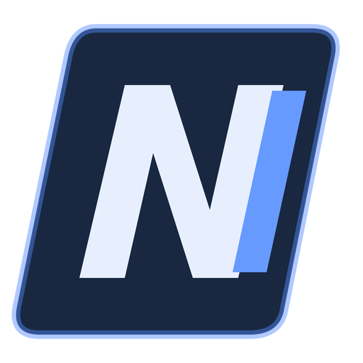
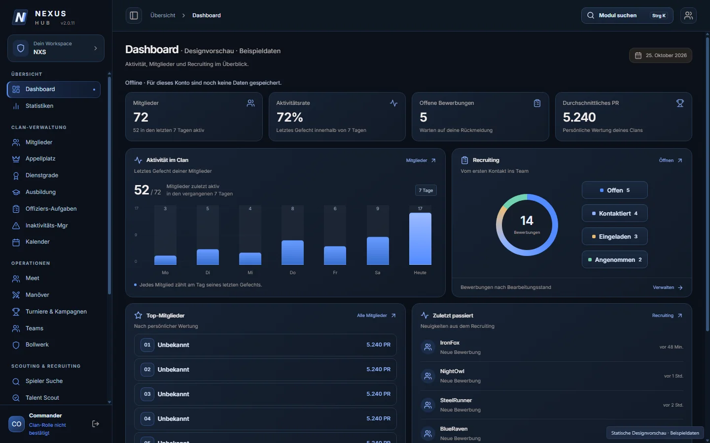

  

<h1 align="center">NEXUS WOT CLAN HUB</h1>

  <b>Dein Clan. Eine Zentrale.</b> 
  Das Clan Operations Center für World of Tanks

  <a href="https://github.com/Vardokr/nexus-hub-releases/releases/latest"><b>Download</b></a> ·
  <a href="#ersteinrichtung">Ersteinrichtung</a> ·
  <a href="#umstieg-von-version-24-oder-älter">Umstieg von 2.4</a> ·
  <a href="https://github.com/Vardokr/nexus-hub-releases/issues">Fehler melden</a>

   
  Beispielansicht mit Demodaten

---

NEXUS WOT CLAN HUB ist eine Windows-Anwendung zur Verwaltung und Organisation von World-of-Tanks-Clans. Mitgliederverwaltung, Recruiting und Einsatzplanung kommen in einer gemeinsamen Oberfläche zusammen. Alle Daten liegen auf dem zentralen NEXUS-Server: keine eigene Datenbank, keine eigenen Schlüssel, Anmeldung nur mit Wargaming.

## Funktionen

- **Dashboard:** Die wichtigsten Clan-Informationen auf einen Blick.
- **Mitglieder & Personalakten:** Spielerwerte, Clan-Ränge, Notizen, Abwesenheiten und Discord-Kontaktdaten. Der Abgleich mit Wargaming läuft automatisch.
- **Ankündigungen & Offiziers-Aufgaben:** Mitteilungen an den Clan und Aufgaben für die Führung, mit Windows-Benachrichtigung.
- **Clan-Wächter:** Beobachtung von Clans und Erfassung von Austritten und Beitritten für das Recruiting.
- **Recruiting & Probezeit:** Bewerbungen in Listen- und Board-Ansicht verwalten, neue Mitglieder durch die Probezeit begleiten.
- **Spielersuche & Talent Scout:** Spieler finden und ihre Werte vergleichen.
- **Anforderungschecker:** Spieler anhand konfigurierbarer Kriterien prüfen.
- **Organisation:** Kalender, Teams, Ausbildung und Dienstgrade.
- **Operationen:** Manöver, Turniere, Kampagnen, Bollwerk und Tank Intel.
- **Statistiken:** Auswertungen zu Mitgliederwerten und Aktivität.
- **Änderungsverlauf:** Wer hat wann was geändert, auch bei gelöschten Einträgen.
- **Discord-Anbindung:** Benachrichtigungen über konfigurierbare Webhooks.
- **Live-Daten:** Änderungen anderer Mitglieder erscheinen sofort, ohne Neuladen.

## Download & Installation

1. Öffne die [Releases](https://github.com/Vardokr/nexus-hub-releases/releases).
2. Lade die Datei `NEXUS-WOT-CLAN-HUB-<Version>-Setup.exe` herunter.
3. Starte den Installer und folge den Anweisungen.

Dieses Repository dient der Bereitstellung von Installationsdateien und Updates.

## Ersteinrichtung

Alle Clans laufen auf dem zentralen NEXUS-Server. Jeder Clan ist über seinen Wargaming-Clan-Tag getrennt und sieht nur seine eigenen Daten.

Der Einrichtungsassistent fragt, was du bist:

1. **Ich leite den Clan** (Kommandant oder Stellvertreter): Mit Wargaming anmelden. Der Clan wird einmalig aktiviert, danach zeigt dir die App den **Clan-Code** im Format `XXXX-XXXX-XXXX`. Gib ihn an deine Mitglieder weiter.
2. **Ich bin Mitglied:** Clan-Code eintragen und mit Wargaming anmelden.
3. **Ich war schon dabei:** Neuer PC oder Neuinstallation: einfach mit Wargaming anmelden, ein Code ist nicht nötig.

Die Clan-Leitung kann unter **Einstellungen → Datenbank** jederzeit einen neuen Clan-Code erzeugen. Der alte Code gilt dann nicht mehr, wer schon beigetreten ist, bleibt Mitglied.

## Umstieg von Version 2.4 oder älter

Bis Version 2.4 brauchte jeder Clan eine eigene Firebase-Datenbank. Ab Version 2.5 laufen alle Clans auf dem zentralen NEXUS-Server.

- Die installierte App bekommt die neue Version als **normales Update** und startet danach einmal im neuen Einrichtungsassistenten.
- **Zuerst die Clan-Leitung:** Kommandant oder Stellvertreter wählt „Ich leite den Clan“ und gibt den Clan-Code weiter. Mitglieder können erst beitreten, wenn ihr Clan aktiviert ist.
- Die bisherigen Clan-Daten wurden auf den Server übernommen, sofern der Clan das vorab mit dem Betreiber abgesprochen hat.

## Daten & Sicherheit

- **Mitgliedschaft:** Der Server prüft bei jeder Anfrage, ob du Mitglied des Clans bist. Wer von der Clan-Leitung entfernt wird, verliert sofort den Zugang.
- **Rang von Wargaming:** Deinen Clan-Rang bestätigt Wargaming. Einige Aktionen sind der Clan-Leitung vorbehalten, zum Beispiel viele Einträge auf einmal zu löschen oder den Clan-Code zu erneuern.
- **Nichts geht verloren:** Frühere Stände der Clan-Daten bewahrt der Server 30 Tage auf. Versehentlich gelöschte oder überschriebene Daten lassen sich wiederherstellen. Dazu kommt eine tägliche Sicherung.
- **Fälschungssicherer Verlauf:** Den Änderungsverlauf schreibt der Server selbst, mit dem echten Spielernamen.
- **Ersatzdienst:** Antwortet Wargaming nicht, nutzt die App für Spielersuche und Mitgliederliste den öffentlichen Dienst [unicum.gg](https://unicum.gg).

## Updates

Die installierte Windows-Version sucht selbst nach Updates. Eine manuelle Prüfung findest du unter:

**Einstellungen → App Info → Nach Updates suchen**

Download und Installation werden in der Anwendung angeboten. Vor dem Neustart solltest du offene Eingaben speichern.

## Hilfe & Fehlerberichte

Die integrierte Hilfe erklärt die wichtigsten Funktionen.

Mit **Strg + Umschalt + L** öffnest du das Diagnoseprotokoll. Bei einem Fehlerbericht helfen:

- Verwendete Version (Einstellungen → App Info)
- Kurze Beschreibung und Schritte zum Nachstellen
- Screenshot oder relevanter Diagnoseauszug

[Fehler melden oder Verbesserung vorschlagen](https://github.com/Vardokr/nexus-hub-releases/issues)

## Entwicklung unterstützen

Wenn dir NEXUS WOT CLAN HUB hilft, kannst du die Weiterentwicklung freiwillig unterstützen:

[Buy me a coffee](https://buymeacoffee.com/vardokr)

## Hinweis

NEXUS WOT CLAN HUB ist ein unabhängiges Community-Projekt und kein offizielles Produkt von Wargaming. World of Tanks und zugehörige Marken gehören ihren jeweiligen Rechteinhabern.
